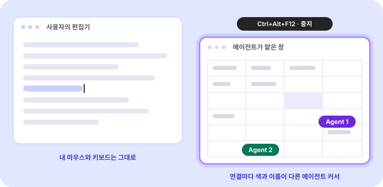
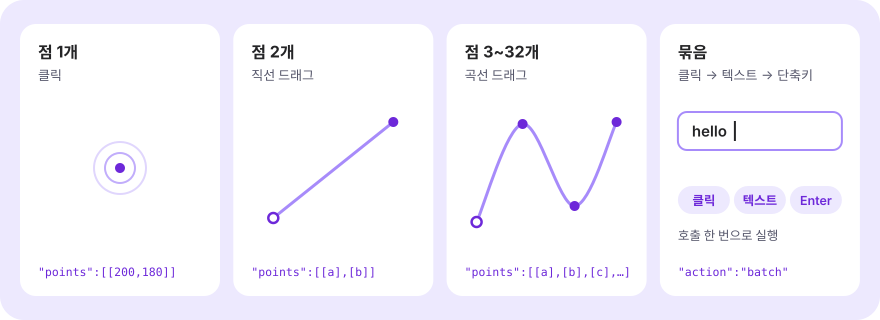
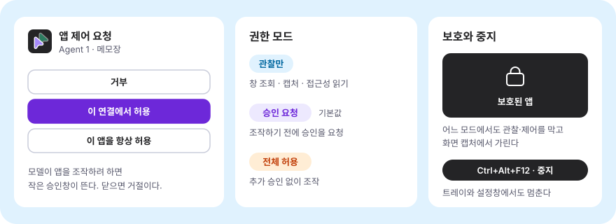
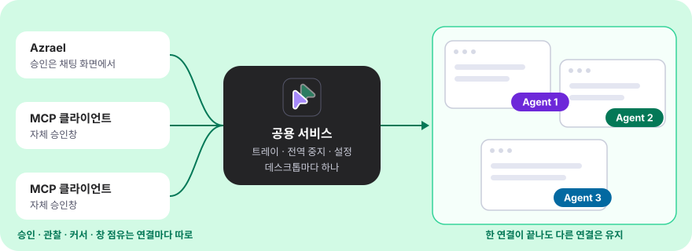

<p align="center"></p>

<h1 align="center">Azrael Window Use</h1>

<p align="center">AI 에이전트가 창 하나를 맡아 조작하는 동안, 마우스와 키보드는 내가 계속 씁니다.</p>

<p align="center"><a href="https://github.com/felrer/azrael-window-use/releases/latest"><b>최신 버전 내려받기</b></a> · <a href="#시작하기">시작하기</a> · <a href="docs/README.md">문서</a></p>



Window Use는 MCP 클라이언트에 창 관찰과 제어 도구를 제공하는 독립 프로그램입니다. Azrael의 창 제어 엔진과 보호 앱 정책을 재사용하며, Azrael·VS Code·Node.js를 따로 설치하지 않아도 배포 패키지만으로 실행됩니다.

## 할 수 있는 일

### 에이전트와 나란히 작업하기

에이전트는 창 목록, 캡처, 접근성 정보로 창을 관찰하고 의미 기반 동작이나 좌표 입력으로 조작합니다. Windows에서는 사용자와 모델의 논리 커서를 분리하는 가상화 입력을 써서, 에이전트가 다른 창을 다루는 동안 내 커서는 제자리에 있습니다. 에이전트 커서가 화면에 표시되므로 무엇을 건드리는지 눈으로 확인할 수 있습니다.

### 클릭, 드래그, 곡선, 묶음 입력



입력은 점의 개수로 정해집니다. 점 하나는 클릭, 둘은 직선 드래그, 셋 이상은 모든 점을 지나는 곡선 드래그입니다. 다른 입력이 끼면 안 되는 클릭 → 텍스트 → 단축키는 한 번의 호출로 묶어 실행합니다. 자세한 규칙은 [입력 자세히](#입력-자세히)에 있습니다.

### 내가 허락한 앱만



모델이 앱을 조작하려 하면 작은 승인창이 뜹니다. 보호된 앱은 어느 모드에서도 관찰과 제어가 막히고 전체 화면 캡처에서 가려집니다. 언제든 단축키, 트레이, 설정창으로 멈출 수 있고, 전달 결과가 불확실한 입력은 자동으로 다시 실행하지 않습니다.

### 여러 에이전트, 서비스 하나



같은 Windows 사용자·로그인 세션·데스크톱에서는 여러 MCP 연결과 Azrael이 공용 서비스 하나에 연결합니다. 트레이와 전역 중지·설정은 서비스가 소유하고, 임시 승인·관찰·커서·창 점유는 연결별로 분리합니다. 한 연결을 종료해도 다른 연결은 유지됩니다. Azrael 연결의 승인은 해당 채팅 UI로 전달하고, 일반 MCP 연결은 자체 승인창을 사용합니다. Azrael의 대화별 권한 제한도 함께 적용됩니다.

## 시작하기

### 내려받기

[최신 릴리스](https://github.com/felrer/azrael-window-use/releases/latest)에서 `WindowUseMCP-<버전>-win32-x64.zip`을 받아 압축을 전부 풉니다. 실행 파일과 `resources` 폴더는 함께 두어야 하며, 실행 파일만 따로 옮기면 동작하지 않습니다.

- 지원 환경: Windows x64의 로컬 대화형 데스크톱, WebView2
- 따로 설치할 필요 없음: Azrael, VS Code, Node.js
- 서명되지 않은 배포물이라 Windows가 알 수 없는 게시자 알림을 표시할 수 있습니다.
- 무결성 확인: 릴리스의 `SHA256SUMS`와 ZIP의 SHA-256을 비교하세요. `build-info.json`에는 빌드 입력과 파일 해시가, `verification.json`에는 수용 검사 결과가 있습니다.

```powershell
Get-FileHash .\WindowUseMCP-*-win32-x64.zip -Algorithm SHA256
```

인터넷에서 새 버전을 받아 오는 자동 업데이트는 없습니다. 새 버전은 릴리스 페이지에서 받아 같은 방법으로 풉니다. 버전별 변경 내용은 [릴리스 노트](https://github.com/felrer/azrael-window-use/releases)에 있습니다.

### 연결

1. **WindowUseMCP.exe**를 열면 설정창이 뜹니다. 미리 실행해 둘 필요는 없습니다.
2. MCP 클라이언트에 **WindowUseMCP.exe**를 명령으로 등록하고 인수에 `--mcp`를 지정합니다.
3. 모델이 앱 제어를 요청하면 승인창에서 거부, 이 연결에서 허용, 이 앱을 항상 허용 중 하나를 고릅니다. 전체 데스크톱 승인은 연결 동안만 유지됩니다.

```json
{
  "mcpServers": {
    "az_window_use": {
      "command": "C:\\Tools\\WindowUseMCP\\WindowUseMCP.exe",
      "args": ["--mcp"]
    }
  }
}
```

설정 파일 형식과 등록 위치는 MCP 클라이언트마다 다릅니다. 위 예시는 `mcpServers` 형식을 쓰는 클라이언트용입니다.

설정·승인창을 닫아도 MCP 연결은 유지됩니다. 다음 권한 요청이 도착하면 승인창을 새로 띄웁니다. 승인창을 닫으면 대기 중인 요청은 거절됩니다. MCP 클라이언트 자체의 도구 승인은 이 프로그램에 요청이 전달되기 전에 별도로 처리될 수 있습니다.

기본 MCP 등록 이름과 서버 자체 이름은 `az_window_use`입니다. 모델에 보이는 namespace는 서버의 자체 이름이 아닌 클라이언트의 등록 키로 정해집니다. Azrael 내장판과 함께 연결할 때는 두 설정을 같은 키에 넣지 마세요. Azrael은 내장판에 `az_window_use`를 사용하고, 같은 키에 있던 외부 설정은 비어 있는 `az_window_use_2`, `az_window_use_3` 등의 별칭으로 보존합니다. 다른 클라이언트에서는 직접 고유한 등록 키를 지정해야 합니다.

### 권한 모드

| 모드 | 동작 |
| --- | --- |
| **관찰만** | 창 조회, 화면 캡처, 접근성 정보 읽기를 허용합니다. |
| **승인 요청** | 관찰은 허용하고, 앱 조작이나 전체 데스크톱 입력에는 승인을 요청합니다. |
| **전체 허용** | 추가 승인 없이 조작하되 보호 앱, 사용자 중지, 대상 검증은 유지합니다. |

- **보호된 앱**: 관찰과 제어를 차단하고 전체 화면 캡처에서 가립니다. 설정·승인 UI는 제거할 수 없는 보호 앱입니다.
- **중지**: 트레이 메뉴, 설정창 또는 `Ctrl+Alt+F12`로 실행을 멈춥니다. 단축키를 다른 프로그램이 쓰고 있으면 트레이나 설정창을 사용하세요. 재개는 설정창에서 직접 실행합니다.

설정 변경과 권한 철회는 기존 화면 참조를 무효화합니다. 다시 화면을 조회해야 하며, 전달 결과가 불확실한 입력은 자동 재실행하지 않습니다. 같은 앱의 창에 대한 제어 충돌은 기존 점유 정책으로 조정합니다.

## 입력 자세히

### 클릭·키보드 묶음

`switched_input`의 `input`에 아래처럼 `batch`를 주면 MCP 한 번의 호출로 실행합니다. 같은 포인터·대상 창 안에서 클릭·대기·텍스트·단축키를 1~16단계로 묶으며, 전체 예약 기본값은 750ms(설정 범위 100~2000ms), 전체 텍스트는 UTF-16 1024단위까지입니다.

```json
{"action":"batch","points":[[200,180]],"maxMs":1500,"steps":[{"action":"click","button":"left"},{"action":"wait","durationMs":1000},{"action":"text","text":"hello"},{"action":"press","keys":[13]}]}
```

위 예시는 `input` 값입니다. `switched_input`은 최신 창 캡처 이미지 왼쪽 위를 `(0, 0)`으로 하는 픽셀 좌표를 사용하며, `desktop_input`은 전체 화면의 물리 좌표를 사용합니다. 바깥 요청의 `windowId`·`observationId` 등은 노출된 도구 정의를 따르세요. `wait`는 단계당 1~1000ms의 고정 대기입니다. 대기 시간의 합은 `maxMs`보다 작아야 하며, 클릭이나 문자 입력에 걸리는 시간도 같은 한도에 포함됩니다. 화면이나 앱 상태를 확인해야 하면 배치를 끝내고 별도로 관찰하세요.

예약 중에는 기존 사용자 커서의 대기 표시가 켜집니다. 사용자와 모델의 키 상태를 분리하고 원래 포커스를 확인한 뒤 보관된 키를 순서대로 전달합니다. `batch.completedSteps`·`failedStep`(0부터 시작)과 `keyboardReservation`의 전달 개수·복원·미해결 상태를 반환하며, 입력 내용은 로그에 남기지 않습니다. 앱 반영까지 보장하는 트랜잭션은 아니므로 실패한 묶음을 새 ID로 재실행하지 말고 결과를 다시 관찰해야 합니다.

원래 창 소멸·포커스 복원 거절·불확실한 입력 전달은 오류로 보고하며 다른 창에 무작정 재전달하지 않습니다. 버퍼는 4096개 이벤트로 제한되고 3072개에서 중단을 요청합니다. 억제 중 물리 Esc는 중단 전용으로 소비하며, 별도 감시 프로세스가 키보드·마우스의 연속 억제를 최대 10초로 제한합니다. 응답 정지나 취소 후 정리가 멈추면 해당 입력 헬퍼만 종료하여 억제를 풀고 모델이 누른 키·버튼 해제를 시도합니다. 강제 복구에서는 보관된 사용자 입력과 원래 포커스를 복원하지 못할 수 있으며 불확실한 입력은 재생하지 않습니다. 기존의 더 짧은 동작 제한은 유지합니다. Unicode 텍스트 입력은 한국어 IME 조합 자체를 가상화하지 않습니다. 실제 물리 키보드 동시 입력과 IME·재매핑 드라이버 호환성은 별도 실기 검증 대상입니다.

복원 대상은 원래 Windows 포커스 HWND입니다. 같은 브라우저 창 안에서 모델이 다른 DOM 입력란을 선택했거나 앱이 입력란을 재생성한 경우의 입력란·선택 영역 복원까지 보장하지는 않습니다.

### 곡선 드래그

`switched_input` 또는 `desktop_input`의 `input.points` 개수로 동작을 선택합니다. 1개는 클릭, 2개는 직선 드래그, 3~32개는 구심 Catmull–Rom(α=0.5) 곡선 드래그입니다. 드래그는 한 번 누르고 전체 경로를 이동한 뒤 뗍니다.

```json
{"points":[[120,300],[220,180],[380,180],[480,300]],"durationMs":1200}
```

선택 창 좌표는 반환된 캡처 이미지 기준이며, 전체 화면 입력은 물리 화면 좌표입니다. 창 이동·크기·DPI 변경으로 관찰이 오래되면 새로 캡처하세요. 공개 입력은 `points`를 사용하며, 이전 `action:"drag"`·`x/y/fromX/fromY` 형식은 받지 않습니다. 연속 중복점은 합치고 모든 점이 같으면 거절합니다. 곡선 길이 기준으로 이동하며 모든 경유점을 포함합니다. 전체 생성 경로가 대상 창·화면 범위를 벗어나거나 2048개 전달 샘플을 초과하면 입력 전에 거절합니다. `durationMs`는 드래그 전체의 목표 시간이며 클릭에는 지정하지 않습니다. 시간은 50~2000ms(기본 300ms)의 목표값이며 OS 처리 때문에 길어질 수 있습니다.

적은 수의 형태 결정 앵커를 이동 순서로 주고 급한 굴곡에 점을 추가하세요. 곡선이 점 사이에서 휘어지므로 장애물·창 경계와 여유를 두고, 서로 다른 획은 별도 요청으로 나누세요. 장애물 자동 회피나 펜 필압은 제공하지 않습니다. [곡선 비교 HTML](docs/visualizations/curve-preview.html)에서 모양을 볼 수 있습니다.

### 협업 모드와 입력 복원

실제 입력 세션은 가상화 협업 모드를 기본으로 요청하며, 오류 후 새 세션에도 적용합니다. 렌더링만 하는 세션은 입력 가로채기를 켜지 않습니다. 장치 등록과 커서·보호 프로세스 초기화가 성공하면 사용자 입력 없이 바로 `ready`가 됩니다. 마우스 이동 대기와 시작 시 250ms 입력 분리 검증은 없습니다. 장치 등록 실패나 실행 중 입력 전달·대상 오류는 계속 보고합니다. 협업 모드의 클릭·드래그·스크롤과 모델 `press`·`text`·`batch`는 사용자 물리 키보드 입력을 잠시 보관합니다. 조작 후 원래 창과 Windows 입력 포커스를 복원하고 보관한 키를 순서대로 전달합니다. 클릭·스크롤 예약은 최대 1000ms, 드래그는 지정 시간에 준비 여유 1000ms를 더해 최대 3000ms입니다. 배치는 대기 중에도 중단할 수 있고, 전체가 끝나거나 중단될 때 한 번 복원합니다. 협업 모드를 명시적으로 끈 경우에는 이 보관·복원이 적용되지 않습니다.

## 플랫폼

배포 패키지는 **Windows x64**용입니다. macOS와 Linux 백엔드는 소스에 있으며 지원 범위가 다릅니다. 빌드 방법과 검증 상태는 [플랫폼 안내](docs/platforms.md)를 확인하세요.

| 기능 | Windows | macOS | Linux X11 | Linux Wayland |
| --- | --- | --- | --- | --- |
| 접근성 기반 관찰·동작 | UI Automation | AXUIElement | AT-SPI | AT-SPI |
| 선택한 창 캡처 | 지원 | ScreenCaptureKit | XComposite | 없음 |
| 사용자와 분리된 좌표 입력 | 가상화 입력 엔진 | 없음 | 없음 | 없음 |
| 전체 데스크톱 캡처·제어 | 지원 | 없음 | 없음 | 없음 |

Windows는 WebView2, macOS는 WKWebView, Linux는 WebKitGTK가 필요합니다. 호스트 구조와 패키징은 [Tauri 호스트 안내](docs/tauri-host.md)에 있습니다.

## 알아 둘 점

- ARM64, 원격 서비스 세션, UAC 보안 데스크톱, 자동 권한 상승은 지원 범위가 아닙니다. 앱마다 UI Automation 지원이 달라 모든 앱의 모든 요소 조작을 보장하지 않습니다.
- 여러 에이전트 커서가 보인다고 해서 독립된 네이티브 입력 포인터가 여러 개라는 뜻은 아닙니다. 같은 앱의 창에 대한 제어 충돌은 점유 정책으로 조정합니다.

이 프로그램은 연결된 MCP 클라이언트에 화면·앱 내용을 반환합니다. 클라이언트가 해당 정보를 모델 서비스로 전송할 수 있으므로 연결과 보호 앱 설정을 직접 관리해야 합니다. 보호 정책은 이 MCP를 통한 실행을 제한하며, 같은 Windows 사용자로 실행되는 다른 프로그램을 격리하지 않습니다. 데스크톱 마스킹은 창 변화 검사를 수행하지만 Windows 합성기의 일시적인 변화에 대한 완전한 보안 격리를 보장하지 않습니다.

### 공용 서비스와 버전 전환

설치본을 실행하면 검증된 설치 후보로 등록하고, 실행 중인 공용 서비스에 연결하거나 서비스를 시작합니다. 더 최신인 호환 설치본을 실행하면 진행 중 요청과 입력 정리를 마친 뒤 서비스가 전환됩니다. 연결 어댑터는 후속 요청에서 다시 연결하며, 임시 승인과 캡처/UIA 참조는 새로 받아야 합니다. 결과가 불확실한 입력을 자동 재실행하지 않습니다. 전역 중지는 전환 후에도 유지됩니다.

인터넷에서 새 버전을 내려받는 자동 업데이트는 포함하지 않습니다. 공용 서비스 프로토콜을 지원하지 않는 기존 실행 파일은 새 구조로 연결하려면 교체·재연결이 필요합니다. 소스 검증과 실제 배포 패키지·설치된 Azrael의 검증은 별개입니다. 자세한 경계는 [공용 서비스 설계](docs/shared-service.md)를 참고하세요.

## 소스에서 빌드하기

실행만 하려면 배포 ZIP을 쓰세요. 개발에는 Windows x64 대화형 데스크톱, Node.js/npm, Rust MSVC 도구 체인, Visual Studio C++·CMake가 필요하고, Windows 검증 스크립트는 테스트 앱을 만들기 위해 .NET Framework C# 컴파일러를 씁니다.

```powershell
git clone https://github.com/felrer/azrael-window-use.git
cd azrael-window-use
npm ci
npm run build:native
npm test
```

소스 실행에는 Rust Tauri 호스트 빌드가 더 필요합니다. [Tauri 호스트 안내](docs/tauri-host.md)의 자원 준비와 실행 절차를 따르세요. 개발용 MCP 연결 예시입니다. 경로는 실제 위치로 바꾸세요.

```json
{
  "mcpServers": {
    "az_window_use": {
      "command": "C:\\Program Files\\nodejs\\node.exe",
      "args": ["C:\\Projects\\azrael-window-use\\scripts\\launch.cjs", "--mcp"]
    }
  }
}
```

소스의 최신 변경과 이미 만든 패키지는 다를 수 있으며, MCP를 다시 연결한다고 패키지 내부 코드가 갱신되지는 않습니다.

### 검증

```text
npm ci
npm run build:native
npm test
node scripts/verify-windows.cjs
node scripts/verify-windows.cjs --virtualization
node scripts/verify-windows.cjs --mouse-keyboard
node scripts/verify-windows.cjs --batch
node scripts/verify-windows.cjs --curve
npm run package
node scripts/verify-windows.cjs --executable <release-folder>\WindowUseMCP.exe
```

실제 Windows 검증은 독립된 테스트 앱·설정 프로필을 생성하고, 표준 SDK 연결·승인·UIA 입력·보호 정책·마스킹·데스크톱 입력·종료를 검사합니다. `--virtualization`은 별도 활성화 요청 없이 기본 가상화 상태를 확인하고 외부 입력 감지량과 클릭·텍스트의 실제 반영을 따로 기록합니다. 외부 이벤트가 있어도 나머지 검사를 진행하며, 가상화 해제·도구 오류·효과 불일치는 실패입니다. 외부 이벤트가 없는 실행은 동시 사용 통과로 인정하지 않습니다. 이 옵션은 제품의 입력 정책이나 중지 기능을 우회하지 않습니다. UI 자동화용 디버깅 포트는 검증 명령에서만 추가되며 일반 실행은 네트워크 포트를 열지 않습니다.

## 저장소 구성

| 경로 | 내용 |
| --- | --- |
| `src/` | 독립 MCP·설정/승인 UI·권한·로그 |
| `src-tauri/` | Rust Tauri 호스트 |
| `native/` | 플랫폼별 창 제어와 Windows 가상화 입력 |
| `vendor/azrael/` | 재사용한 Azrael 어댑터·출처·고지 |
| `scripts/`·`tests/` | 빌드·패키징·검증 |
| `docs/`·`work/` | 설계·운영 문서와 검증 기록 |

`node_modules/`, `artifacts/`, `dist/`, `*.log`는 Git에서 제외됩니다. 개인 설정·승인·로그는 저장소에 커밋하지 마세요.

## 문서와 출처

- [구조와 권한](docs/architecture.md)
- [공용 서비스 설계](docs/shared-service.md)
- [Tauri 호스트](docs/tauri-host.md) · [플랫폼 백엔드](docs/platforms.md)
- [설치·배포·로그](docs/distribution.md)
- [아이콘과 에이전트 커서](docs/icon-assets.md)
- [Azrael 원본 코드와 해시](vendor/azrael/SOURCE.json)

MIT 라이선스입니다. 재사용한 코드·커서·네이티브 의존성의 개별 고지는 소스와 배포물에 함께 포함합니다.
